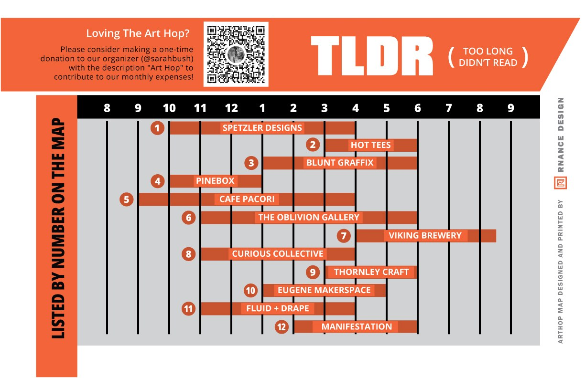

[Home](Home.md) / Map <!-- wikidown:breadcrumb -->

# Map

Tap a numbered circle on the map to open that venue's page. Directions links below open Google Maps with the address already filled in.

<svg viewBox="0 0 1182 588" role="img" aria-label="November Art Hop map, Saturday November 7 2026. Tap a numbered circle to open that venue's page." style="width:100%;height:auto;border:1px solid #e3e3e3;border-radius:6px">
<image href=".attachments/maps/2026-11-map.jpg" x="0" y="0" width="1182" height="588"/>
<a href="Venues/Spetzler-Designs.md"><circle class="hotspot" cx="1005" cy="521" r="22"/><title>Spetzler Designs - 2100 W Broadway #19, Eugene, OR</title></a>
<a href="Venues/Hot-Tees.md"><circle class="hotspot" cx="800" cy="94" r="22"/><title>Hot Tees - 2633 Roosevelt Blvd, Eugene, OR</title></a>
<a href="Venues/Blunt-Graffix.md"><circle class="hotspot" cx="360" cy="242" r="17"/><title>Blunt Graffix - 3709 W 1st Ave, Eugene, OR</title></a>
<a href="Venues/Pinebox.md"><circle class="hotspot" cx="1082" cy="384" r="22"/><title>Pinebox - 575 Garfield St, Eugene, OR</title></a>
<a href="Venues/Caffe-Pacori.md"><circle class="hotspot" cx="436" cy="356" r="22"/><title>Caffe Pacori - 255 Wallis St, Eugene, OR</title></a>
<a href="Venues/The-Oblivion-Gallery.md"><circle class="hotspot" cx="283" cy="120" r="22"/><title>The Oblivion Gallery - 3923 Cross St, Eugene, OR</title></a>
<a href="Venues/Viking-Brewing.md"><circle class="hotspot" cx="119" cy="394" r="22"/><title>Viking Brewing - 520 Commercial St, Eugene, OR</title></a>
<a href="Venues/Curious-Collective.md"><circle class="hotspot" cx="505" cy="504" r="22"/><title>Curious Collective - 1090 Bailey Hill Rd, Ste I, Eugene, OR</title></a>
<a href="Venues/Thornley-Craft-Construction.md"><circle class="hotspot" cx="577" cy="520" r="22"/><title>Thornley Craft Construction - 1123 Bailey Hill Rd, Units 30 &amp; 31, Eugene, OR</title></a>
<a href="Venues/Eugene-Makerspace.md"><circle class="hotspot" cx="310" cy="300" r="22"/><title>Eugene Makerspace - 3890 W 1st Ave, Eugene, OR</title></a>
<a href="Venues/Fluid-Drape.md"><circle class="hotspot" cx="203" cy="476" r="22"/><title>Fluid Drape - 4216 West 7th Ave unit J, Eugene, OR</title></a>
</svg>

### At a glance

[View the full printed map](.attachments/maps/2026-11.jpg)

- **1. [Fluid Drape](Venues/Fluid-Drape.md)** — 4216 West 7th Ave unit J, Eugene, OR · 11am to 4pm · [Directions](https://www.google.com/maps/dir/?api=1&destination=44.05125,-123.16375)
- **2. [Spetzler Designs](Venues/Spetzler-Designs.md)** — 2100 W Broadway #19, Eugene, OR · 10am to 4pm · [Directions](https://www.google.com/maps/dir/?api=1&destination=44.04958,-123.12497)
- **3. [Caffe Pacori](Venues/Caffe-Pacori.md)** — 255 Wallis St, Eugene, OR · 9am to 4pm · [Directions](https://www.google.com/maps/dir/?api=1&destination=44.05646,-123.15392)
- **4. [Curious Collective](Venues/Curious-Collective.md)** — 1090 Bailey Hill Rd, Ste I, Eugene, OR · 11am to 4pm · [Directions](https://www.google.com/maps/dir/?api=1&destination=44.0483,-123.14832)
- **5. [The Oblivion Gallery](Venues/The-Oblivion-Gallery.md)** — 3923 Cross St, Eugene, OR · 11am to 6pm · [Directions](https://www.google.com/maps/dir/?api=1&destination=44.06337,-123.16021)
- **6. [Hot Tees](Venues/Hot-Tees.md)** — 2633 Roosevelt Blvd, Eugene, OR · 3pm to 6pm · [Directions](https://www.google.com/maps/dir/?api=1&destination=44.06394,-123.13537)
- **7. [Eugene Makerspace](Venues/Eugene-Makerspace.md)** — 3890 W 1st Ave, Eugene, OR · 1pm to 5pm · [Directions](https://www.google.com/maps/dir/?api=1&destination=44.05793,-123.15978)
- **8. [Viking Brewing](Venues/Viking-Brewing.md)** — 520 Commercial St, Eugene, OR · 4pm to 8:30pm · [Directions](https://www.google.com/maps/dir/?api=1&destination=44.05425,-123.16771)
- **9. [Thornley Craft Construction](Venues/Thornley-Craft-Construction.md)** — 1123 Bailey Hill Rd, Units 30 & 31, Eugene, OR · 2pm to 5pm · [Directions](https://www.google.com/maps/dir/?api=1&destination=44.04696,-123.14761)
- **10. [Pinebox](Venues/Pinebox.md)** — 575 Garfield St, Eugene, OR · 10am to 1pm · [Directions](https://www.google.com/maps/dir/?api=1&destination=44.05371,-123.1227)
- **11. [Blunt Graffix](Venues/Blunt-Graffix.md)** — 3709 W 1st Ave, Eugene, OR · 1pm to 6pm · [Directions](https://www.google.com/maps/dir/?api=1&destination=44.05858,-123.15703)
